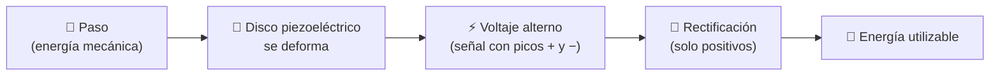

<div align="center">

# ⚡ SIREP ⚡
### Cada paso cuenta: convierte tu caminar en electricidad


**🌐 [Ver la página web interactiva](https://TU-USUARIO.github.io/TU-REPOSITORIO/)** · 📸 [Evidencias](#-evidencias-y-pruebas) · 🧠 [Aprende la ciencia](#-la-ciencia-detrás-explicada-fácil) · 👟 [Cómo usarla](#-cómo-usar-sirep-correctamente)

<!-- 📷 Reemplaza con una foto de la baldosa -->
<!--  -->

</div>

---

## 📖 Índice

1. [¿Qué es SIREP?](#-qué-es-sirep)
2. [El problema](#-el-problema-energía-que-se-pierde-en-cada-paso)
3. [La solución](#-la-solución-una-baldosa-que-escucha-tus-pasos)
4. [La ciencia explicada fácil](#-la-ciencia-detrás-explicada-fácil)
5. [Cómo usar SIREP correctamente](#-cómo-usar-sirep-correctamente)
6. [Evidencias y pruebas](#-evidencias-y-pruebas)
7. [Retos y lecciones aprendidas](#-retos-fallas-y-lecciones-aprendidas)
8. [Conclusión](#-conclusión)
9. [El equipo](#-el-equipo)

---

## 🔌 ¿Qué es SIREP?

**SIREP** es una baldosa que transforma la presión de un paso en voltaje. Cada vez que alguien camina sobre ella, el movimiento (energía mecánica) se convierte en energía eléctrica.

> 💡 **Idea en una frase:** miles de pasos al día en nuestro colegio son energía que hoy se pierde. SIREP quiere aprovecharla.

---

## 🏫 El problema: energía que se pierde en cada paso

| | |
|---|---|
| 😟 **Problema** | Se desperdicia la energía mecánica de las personas que se mueven dentro del colegio. |
| 👥 **¿A quién afecta?** | A todas las personas de la institución: estudiantes, docentes y personal. |
| 🇨🇴 **Contexto** | En nuestro país el aprovechamiento de la energía mecánica casi no se aplica todavía. |

Cada recreo, cada cambio de clase y cada pasillo lleno son pasos que presionan el piso y no dejan nada. **¿Y si ese movimiento pudiera servir para algo?**

---

## 🧩 La solución: una baldosa que escucha tus pasos

Al ejercer presión de forma continua sobre la baldosa, esta genera energía. **Con un solo paso, el movimiento se transforma en voltaje.**



---

## 🧠 La ciencia detrás, explicada fácil

> 📌 Solo necesitas saber que la energía **no se crea ni se destruye: se transforma**.

### 💎 1. Piezoelectricidad
Algunos materiales (como el cuarzo o la cerámica de los discos de los timbres y zumbadores) generan una pequeña carga eléctrica cuando se **aprietan o se doblan**. La palabra viene del griego *piezo*, "presionar". Es como si el material "se quejara" con electricidad al ser apretado.

### 🔄 2. Transformación de energía
Tu paso tiene energía de movimiento. El disco piezoeléctrico la convierte en energía eléctrica. Es el mismo principio de una linterna de manivela: mueves algo y aparece electricidad. *(Una parte siempre se pierde como calor y sonido: ningún proceso es 100 % eficiente.)*

### 〰️ 3. Rectificación de una onda
Al pisar, el disco produce una señal que sube y baja: **voltaje alterno** (positivo y negativo). Para guardar o usar esa energía necesitamos que vaya siempre en un solo sentido. Un **rectificador** (con diodos) actúa como una válvula de un solo sentido: voltea los picos negativos para que todos queden hacia arriba.

```
Señal del disco:        Después de rectificar:
   /\    /\                /\  /\  /\  /\
--/--\--/--\--          --/--\/--\/--\/--\--
       \/  \/
```

---

## 👟 Cómo usar SIREP correctamente

> ## ⚠️ ¡SIREP **NO** es una plataforma para saltar!

Los discos piezoeléctricos son delicados. Si la exigimos de más, se rompe y nadie puede disfrutarla.

| ✅ Sí | ❌ No |
|---|---|
| Camina sobre ella con un paso normal | Saltar o dar golpes fuertes |
| Pisa la zona marcada, de a una persona | Pararse varias personas a la vez |
| Disfruta viendo cómo se genera la señal | Arrastrar objetos pesados sobre ella |
| Cuida y respeta el prototipo | Sentarse, apoyar mesas o carros |

---

## 🔬 Evidencias y pruebas

Probamos SIREP de varias formas para estar seguros de lo que afirmamos:

| 🧪 Tipo de prueba | 📋 Qué hicimos |
|---|---|
| 💻 Simulaciones | Modelamos el circuito antes de construirlo |
| ⚖️ Comparación | Contrastamos SIREP con otra solución |
| 🔧 Pruebas físicas | Verificamos el funcionamiento del prototipo real |
| 📏 Mediciones experimentales | Medimos el voltaje generado y la limitación de la capacidad de carga |
| 🖥️ Capturas de pantalla | Registramos simulaciones y mediciones |
| 📷 Fotografías | Documentamos cada etapa de construcción |

### ⭐ Prueba estrella: la señal en el osciloscopio

Un **osciloscopio** es una "cámara" para ver el voltaje: dibuja cómo cambia en el tiempo. Con él pudimos **ver** la señal eléctrica que produce un paso sobre SIREP.

<!-- 📷 Pega aquí tu captura del osciloscopio -->
<!--  -->

> 📝 **Completa con tus datos reales:** voltaje máximo medido: `____ V` · condiciones de la prueba: `____`

### 📸 Galería

| Construcción | Simulación | Mediciones |
|:---:|:---:|:---:|
| *(foto)* | *(captura)* | *(foto)* |

---

## 🚧 Retos, fallas y lecciones aprendidas

> 🧗 Un proyecto honesto también cuenta lo que **no** salió bien.

<details>
<summary><b>🧱 Reto 1: los materiales comerciales son muy frágiles</b></summary>

Los discos piezoeléctricos comerciales no soportan un peso alto. Al aumentar la carga, el rendimiento y la integridad del sistema se ven afectados.
</details>

<details>
<summary><b>🔥 Reto 2: las soldaduras se quebraban</b></summary>

Los puntos de soldadura de los discos se quebraban una y otra vez, incluso cuando intentamos protegerlos. Es el punto débil del diseño.
</details>

<details>
<summary><b>🎓 Lecciones aprendidas</b></summary>

- Probar con materiales reales es la única forma de conocer sus límites.
- Una simulación ayuda, pero no reemplaza el prototipo físico.
- Documentar las fallas es tan valioso como documentar los éxitos.
</details>

---

## ✅ Conclusión

**Los piezoeléctricos comerciales estándar no son viables para proyectos de alto peso o tráfico pesado.**

SIREP demuestra que el principio funciona y que podemos *ver* la energía de un paso, pero para un uso intensivo hacen falta materiales y soldaduras más robustos. Esa es nuestra mayor enseñanza y la base para quien quiera continuar el proyecto. 🚀

---

## 👥 El equipo

| 👤 Integrante |
|---|
| **Matthew Colmenares** |
| **Santiago García** |
| **Jerónimo Guerrero** |
| **Mariana Moyano** |

---

<div align="center">

🏫 Proyecto escolar · Hecho con curiosidad y mucha paciencia ⚡

</div>
